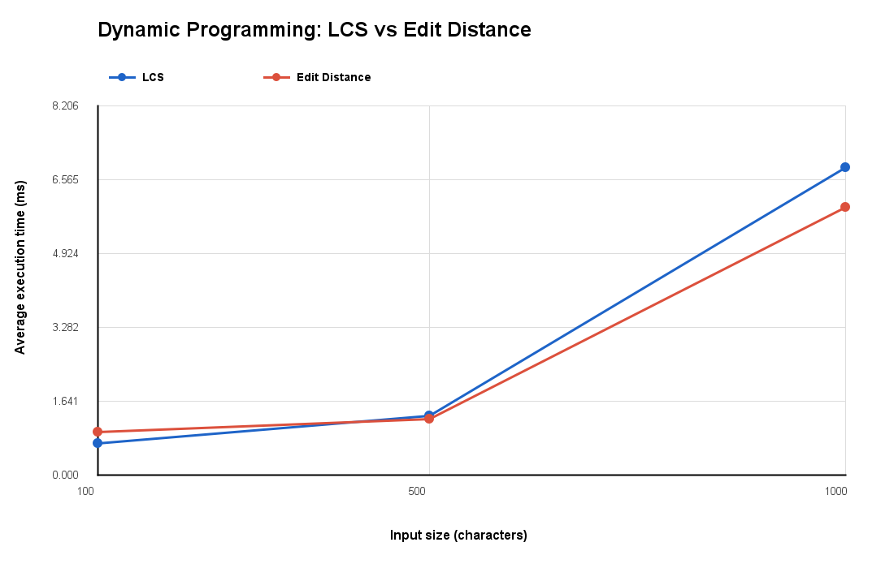
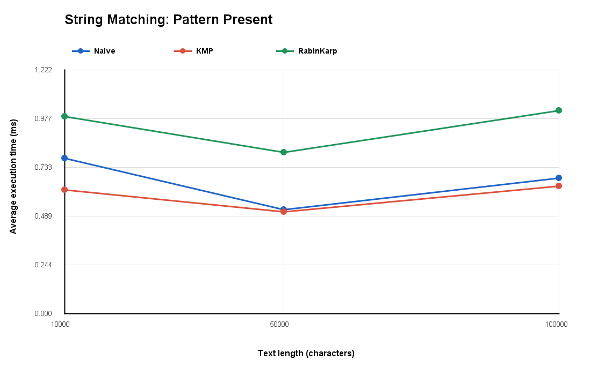
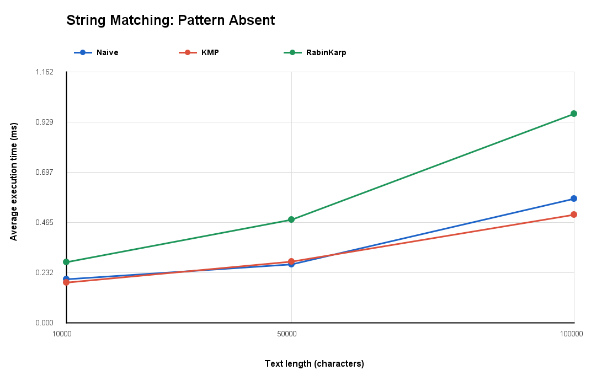

# Assignment 4 — Text Analysis: Dynamic Programming and String Algorithms

**ANEL MELIS — SE-2527**

## 1. Project Overview

This project focuses on implementing, testing, and comparing six text analysis algorithms using Java. The algorithms cover Dynamic Programming, String Matching, and Advanced String Algorithms.

The main objectives of this assignment are:

- Implement all required algorithms independently in Java.
- Understand the working principles of each algorithm.
- Analyze theoretical time and space complexity using Big-O notation.
- Test correctness using normal and edge cases.
- Measure execution time using different input sizes.
- Compare theoretical complexity with experimental performance.
- Present the results using tables and graphs.

### Implemented Algorithms

**Part A — Dynamic Programming**

1. Longest Common Subsequence (LCS)
2. Edit Distance (Levenshtein Distance)

**Part B — String Matching**

3. Naive String Matching
4. Knuth–Morris–Pratt (KMP)
5. Rabin–Karp

**Part C — Advanced String Algorithm**

6. Kasai's Algorithm for Longest Common Prefix (LCP) Array

All six algorithms are implemented in separate Java classes.

## 2. Project Structure

```text
daa4asik/
│
├── src/
│   ├── algorithms/
│   │   ├── dp/
│   │   │   ├── LCS.java
│   │   │   └── EditDistance.java
│   │   │
│   │   ├── sm/
│   │   │   ├── NaiveStringMatching.java
│   │   │   ├── KMP.java
│   │   │   └── RabinKarp.java
│   │   │
│   │   └── aca/
│   │       └── Kasai.java
│   │
│   ├── tests/
│   │   └── AlgorithmTests.java
│   │
│   └── experiments/
│       └── AlgorithmExperiments.java
│
├── results/
│   ├── benchmark_results.csv
│   ├── dp_comparison.png
│   ├── string_matching_present.png
│   └── string_matching_absent.png
│
├── .gitignore
└── README.md
```

The project separates algorithms, testing, and experimental evaluation into different packages. This organization makes the implementations easier to understand, maintain, test, and reproduce.

## 3. Algorithm Implementations

### 3.1. Longest Common Subsequence (LCS)

The Longest Common Subsequence algorithm finds the length of the longest subsequence shared by two strings.

A subsequence consists of characters appearing in the same relative order, but they do not have to be consecutive.

**Example:**

```text
String 1: ABCDE
String 2: ACE

LCS: ACE
Length: 3
```

**Implementation**

The algorithm uses a two-dimensional Dynamic Programming table `dp[m+1][n+1]`, where `m` and `n` represent the lengths of the two strings.

**Base cases:**

```text
dp[i][0] = 0
dp[0][j] = 0
```

If the current characters match:

```text
dp[i][j] = dp[i-1][j-1] + 1
```

Otherwise:

```text
dp[i][j] = max(dp[i-1][j], dp[i][j-1])
```

**Why the recurrence is correct**

When the last characters of two prefixes match, they can extend a common subsequence by one character. Therefore, the algorithm adds one to the result for the previous prefixes.

When the characters do not match, a longest common subsequence must exclude at least one of the two current characters. The algorithm considers both possibilities and selects the larger result.

The base cases are correct because an empty string has no nonempty common subsequence with another string.

The final result is stored in `dp[m][n]`.

**Implementation decision:** The program returns the length of the LCS rather than reconstructing the subsequence itself, as required by the assignment.

### 3.2. Edit Distance (Levenshtein Distance)

Edit Distance calculates the minimum number of operations required to transform one string into another.

Three operations are supported:

- Insertion — adding a character.
- Deletion — removing a character.
- Substitution — replacing a character.

Each operation has a cost of one.

**Example:**

```text
String 1: CAT
String 2: CUT

CAT → CUT

Edit Distance: 1
```

Only one substitution is required.

**Implementation**

The algorithm uses a two-dimensional Dynamic Programming table.

**Base cases:**

```text
dp[i][0] = i
dp[0][j] = j
```

If the current characters match:

```text
dp[i][j] = dp[i-1][j-1]
```

Otherwise:

```text
dp[i][j] = 1 + min(
    dp[i][j-1],
    dp[i-1][j],
    dp[i-1][j-1]
)
```

**Why the recurrence is correct**

When characters match, no additional editing operation is required.

When they differ, the last operation of an optimal transformation must be an insertion, deletion, or substitution. The algorithm evaluates all three possibilities and chooses the minimum cost.

The base cases represent the number of insertions or deletions required when one string is empty.

By calculating the optimal result for smaller prefixes, the algorithm obtains the minimum edit distance for the complete strings.

### 3.3. Naive String Matching

Naive String Matching searches for all occurrences of a pattern inside a text.

It compares the pattern with the text at every possible starting position.

If a mismatch occurs, the algorithm moves the starting position by one character and repeats the comparison.

**Example:**

```text
Text:    ABABCABABC
Pattern: ABC

Result: [2, 7]
```

**Main steps:**

1. Start at the first possible position.
2. Compare the pattern characters with the text.
3. If all characters match, record the starting index.
4. Move to the next possible position.
5. Continue until all positions have been checked.

This algorithm is used as a baseline for comparing the more advanced string-matching algorithms.

The implementation also records the number of direct character comparisons.

### 3.4. Knuth–Morris–Pratt (KMP)

KMP is a string-matching algorithm that avoids unnecessary repeated comparisons.

Unlike Naive String Matching, KMP uses information about previously matched characters.

The algorithm uses a preprocessing table called LPS (Longest Prefix Suffix).

LPS stores the length of the longest proper prefix that is also a suffix for each prefix of the pattern.

**Example:**

```text
Pattern: A B A B C
LPS:     0 0 1 2 0
```

**Implementation**

KMP consists of two stages.

**Stage 1 — Preprocessing**

The algorithm constructs the LPS table for the pattern.

**Stage 2 — Searching**

The algorithm compares text and pattern characters. When a mismatch occurs, it uses the LPS table to determine the next pattern position without restarting the search from the beginning.

This reduces unnecessary character comparisons.

**Implementation decisions:**

- The LPS array is constructed manually.
- The searching algorithm returns all occurrence indices.
- Overlapping occurrences are supported.
- Preprocessing comparisons and search comparisons are recorded separately.

### 3.5. Rabin–Karp

Rabin–Karp is a string-matching algorithm based on hashing.

Instead of directly comparing every pattern character with every text window, it calculates hash values.

The implementation uses:

```text
BASE = 256
MOD  = 1,000,000,007
```

**Main steps:**

1. Calculate the hash of the pattern.
2. Calculate the hash of the first text window.
3. Compare the two hash values.
4. If the hashes match, verify the actual characters.
5. Use a rolling hash to calculate the next window's hash.
6. Continue searching until the end of the text.

**Rolling Hash**

Rolling hashing allows the hash value to be updated by removing the outgoing character and adding the incoming character without recalculating the entire window hash.

**Hash Collisions**

A hash collision occurs when two different strings produce the same hash value.

To handle collisions correctly, the implementation performs a direct character-by-character verification whenever the hash values match.

Therefore, a hash match alone does not guarantee that the pattern occurs in the text.

**Operation counts**

The implementation separately records:

- Hash comparisons — comparisons between the pattern hash and a text-window hash.
- Character comparisons — direct comparisons performed during verification.

These two operations are reported separately because they represent different types of computational work.

### 3.6. Kasai's Algorithm

Kasai's algorithm constructs the Longest Common Prefix (LCP) array using a string and its suffix array.

A suffix is a substring beginning at a particular position and continuing to the end of the original string.

A suffix array contains the starting indices of all suffixes sorted lexicographically.

The LCP array stores the number of common starting characters between adjacent suffixes in sorted order.

**Example:**

```text
Text: banana

Suffix Array:
[5, 3, 1, 0, 4, 2]

LCP Array:
[0, 1, 3, 0, 0, 2]
```

**Manually verified example:**

| Suffix Index | Suffix | LCP with Previous |
|---:|---|---:|
| 5 | a | 0 |
| 3 | ana | 1 |
| 1 | anana | 3 |
| 0 | banana | 0 |
| 4 | na | 0 |
| 2 | nana | 2 |

**Implementation steps:**

1. Construct the inverse suffix array, also called the rank array.
2. Iterate through the original string.
3. Identify the preceding suffix in lexicographical order.
4. Compare the two suffixes to calculate their common prefix.
5. Reuse the previous matching length to reduce comparisons.

**Implementation decision:** Kasai receives an already constructed suffix array. The construction of the suffix array is not part of the Kasai algorithm's measured execution time.

## 4. Complexity Analysis

Theoretical complexity describes how the computational cost changes when input sizes increase.

For Dynamic Programming, `m` and `n` represent the lengths of the two input strings.

For String Matching, `n` represents the text length and `m` represents the pattern length.

For Kasai, `n` represents the string length.

### 4.1. Complexity Table

| Algorithm | Main Operation / Recurrence | Best-case Time | Worst-case Time | Auxiliary Space |
|---|---|---|---|---|
| LCS | DP recurrence and character comparison | Θ(m × n) | Θ(m × n) | O(m × n) |
| Edit Distance | Minimum of insertion, deletion, substitution | Θ(m × n) | Θ(m × n) | O(m × n) |
| Naive | Character comparison at each alignment | Θ(n − m + 1) | O((n − m + 1) × m) | O(1) |
| KMP | LPS construction and pattern comparison | O(n + m) | O(n + m) | O(m) |
| Rabin–Karp | Rolling hash and character verification | O(n + m) expected | O(n × m) | O(1) |
| Kasai | Rank array and LCP comparisons | Θ(n) | Θ(n) | O(n) |

The string-matching bounds assume a nonempty pattern whose length does not exceed the text length. Output storage is excluded from auxiliary space estimates.

### 4.2. Complexity Justification

**LCS — Θ(m × n)**

The implementation fills a DP table containing a number of cells proportional to the product of the two input lengths. Each cell is calculated once using a constant amount of work.

Therefore, the time complexity is Θ(m × n), and the table requires O(m × n) additional memory.

**Edit Distance — Θ(m × n)**

The algorithm calculates each cell of a two-dimensional DP table. Each calculation involves character comparison and a constant number of arithmetic operations.

As a result, both time and auxiliary memory grow proportionally to m × n.

**Naive String Matching**

The algorithm checks up to n − m + 1 starting positions.

In the best case, a mismatch occurs immediately at each position, requiring a constant amount of work per alignment.

In the worst case, up to m characters must be checked at every alignment.

Therefore, the worst-case time complexity is O((n − m + 1) × m).

The algorithm uses a constant amount of auxiliary memory, excluding the output list.

**KMP — O(n + m)**

Constructing the LPS table takes O(m) time.

The searching process takes O(n) time because previously matched information is reused rather than repeatedly restarting the search.

The total time is O(n + m).

The LPS table requires O(m) additional memory.

**Rabin–Karp**

The algorithm calculates the initial hashes in O(m) time and updates each following window hash in constant time.

Under typical conditions, only a limited number of windows require complete character verification, giving expected time O(n + m).

However, in the worst case, repeated hash collisions or many actual matches may require O(m) verification work at many positions.

Therefore, the worst-case complexity is O(n × m).

The algorithm uses constant auxiliary space, excluding the returned occurrence list.

**Kasai — Θ(n)**

Kasai builds the inverse suffix array in O(n) time.

During LCP construction, the matching length from the previous comparison is reused and decreased by at most one between iterations.

This prevents the algorithm from repeatedly comparing the same long prefixes from the beginning.

Consequently, LCP construction takes Θ(n) time and uses O(n) auxiliary space.

### 4.3. Theoretical vs Measured Complexity

Big-O describes asymptotic growth rather than exact execution time.

Two algorithms with similar theoretical complexity may have different measured execution times because of implementation details, memory allocation, JVM optimization, and hardware behavior.

Therefore, the experimental measurements in Section 7 are used to complement, rather than replace, theoretical complexity analysis.

## 5. Testing Strategy and Results

Correctness testing was performed using `AlgorithmTests.java`.

The tests cover the required normal cases and edge cases.

### 5.1. LCS Tests

The following cases were tested:

- Identical strings.
- Completely different strings.
- An empty string.
- Strings with a common subsequence.

**Result:** 4 checks passed.

### 5.2. Edit Distance Tests

The following cases were tested:

- Identical strings.
- One empty string.
- Substitution.
- Insertion.
- Deletion.

**Result:** 5 checks passed.

### 5.3. String Matching Tests

The following cases were tested:

- Pattern at the beginning.
- Pattern in the middle.
- Pattern at the end.
- Multiple occurrences.
- Pattern absent from the text.
- Pattern longer than the text.
- Empty pattern.

For every test scenario, Naive, KMP, and Rabin–Karp were checked against the expected occurrence indices.

Additional checks verified that all three algorithms returned identical lists of indices.

**Result:** 35 checks passed.

### 5.4. Kasai Test

The string `banana` was used with a manually verified suffix array.

```text
Suffix Array:
[5, 3, 1, 0, 4, 2]

Expected LCP:
[0, 1, 3, 0, 0, 2]
```

The implementation produced the expected LCP array.

**Result:** 1 check passed.

### 5.5. Final Testing Results

| Test Category | Passed | Failed |
|---|---:|---:|
| LCS | 4 | 0 |
| Edit Distance | 5 | 0 |
| String Matching | 35 | 0 |
| Kasai | 1 | 0 |
| **Total** | **45** | **0** |

Console output:

```text
TESTING SUMMARY

Passed: 45
Failed: 0
Total: 45

All tests passed successfully!

Process finished with exit code 0
```

All 45 checks passed in the latest testing run.

### 5.6. Implementation Assumptions

The following assumptions are used throughout the project:

- String comparisons are case-sensitive.
- String matching uses zero-based indexing.
- Overlapping occurrences are included.
- An empty pattern is considered to match at every position from 0 through the text length.
- A pattern longer than the text returns an empty list.
- LCS returns the length of the common subsequence.
- Edit Distance uses unit costs for insertion, deletion, and substitution.
- Kasai receives a valid suffix array as input.

## 6. Experimental Setup

The experiments evaluate the practical performance of the implemented algorithms.

### 6.1. Development Environment

| Component | Configuration |
|---|---|
| Programming Language | Java |
| JDK | Java 25 |
| IDE | IntelliJ IDEA 2025.3.1 |
| Operating System | Windows |
| Timing Method | System.nanoTime() |
| Measurements per Experiment | 5 |
| Warm-up Runs | 3 |
| Random Seed | 20261031 |
| Alphabet | ABCD |

The same experimental methodology is used across the required algorithm categories.

### 6.2. Input Sizes

| Algorithm | Input Sizes |
|---|---|
| LCS | 100, 500, 1,000 |
| Edit Distance | 100, 500, 1,000 |
| String Matching | 10,000, 50,000, 100,000 |
| Kasai | 1,000, 5,000, 10,000 |

For LCS and Edit Distance, two strings of equal length are generated for each input size.

For String Matching, pattern length is fixed at 10 characters.

For Kasai, strings of the required lengths are generated and their suffix arrays are prepared before timing.

### 6.3. Random Input Generation

Random strings are generated using the fixed seed:

```java
private static final long SEED = 20261031L;
```

The alphabet is:

```java
private static final String ALPHABET = "ABCD";
```

Using a fixed seed makes input generation reproducible.

All three string-matching algorithms use the same text and pattern within each comparison.

Two scenarios are evaluated:

**Pattern Present:** A pattern is selected from the generated text, guaranteeing at least one occurrence.

**Pattern Absent:** A pattern that does not occur in the text is generated.

### 6.4. Execution Time Measurement

Execution time is measured using Java's `System.nanoTime()`.

Each experiment includes:

1. Three warm-up executions.
2. Five timed executions.
3. Calculation of the average execution time.
4. Conversion from nanoseconds to milliseconds.

Average execution time is calculated as:

\[
\text{Average Time (ms)} =
\frac{\sum_{i=1}^{5} t_i}{5 \times 10^6}
\]

where \(t_i\) is the execution time of one run measured in nanoseconds.

Input generation, console output, file writing, and graph generation are excluded from the timed regions.

### 6.5. Operation Counting

In addition to execution time, the program records relevant operation counts for String Matching.

| Algorithm | Recorded Operations |
|---|---|
| Naive | Character comparisons |
| KMP | LPS preprocessing and search character comparisons |
| Rabin–Karp | Hash comparisons and verification character comparisons |

The latest implementation separates timing from operation counting.

During the timed executions, counting is disabled. A separate execution is then performed with counting enabled to obtain the operation counts.

The conditional checks associated with enabling or disabling the counters are still part of the implementation, but the counter increments are excluded from the timed runs.

### 6.6. Kasai Timing

For Kasai's algorithm, the suffix array is constructed before the timed region.

Therefore, the measured execution time represents LCP array construction only.

Suffix array construction is not included because it is not part of the required Kasai implementation.

### 6.7. Experimental Output

The program automatically generates the following files:

```text
results/
├── benchmark_results.csv
├── dp_comparison.png
├── string_matching_present.png
└── string_matching_absent.png
```

The CSV contains execution time and operation counts for each experiment.

The PNG files visualize performance differences between algorithms.

## 7. Experimental Results

This section presents the results obtained from the latest experimental execution.

All execution times are reported as averages of five timed runs, measured in milliseconds.

The complete dataset is available in `results/benchmark_results.csv`.

### 7.1. Dynamic Programming Results

The following table compares LCS and Edit Distance across three input sizes.

| Input Size | LCS (ms) | Edit Distance (ms) |
|---:|---:|---:|
| 100 | 0.703740 | 0.964600 |
| 500 | 1.333420 | 1.254720 |
| 1,000 | 6.838500 | 5.959560 |

**Execution Time vs Input Size**



**Analysis**

Both algorithms show increasing execution times as input size grows.

At an input size of 100, LCS was faster than Edit Distance. However, at sizes 500 and 1,000, Edit Distance was slightly faster in the measured runs.

These differences do not change the theoretical complexity of either algorithm.

Both implementations use a two-dimensional DP table and have Θ(m × n) time complexity.

### 7.2. String Matching Results — Pattern Present

The following table compares the three string-matching algorithms when the pattern is present in the text.

| Text Length | Algorithm | Average Time (ms) | Preprocessing | Hash Comparisons | Character Comparisons |
|---:|---|---:|---:|---:|---:|
| 10,000 | Naive | 0.778960 | 0 | 0 | 13,331 |
| 10,000 | KMP | 0.621020 | 12 | 0 | 12,279 |
| 10,000 | Rabin–Karp | 0.989600 | 0 | 9,991 | 10 |
| 50,000 | Naive | 0.522820 | 0 | 0 | 66,829 |
| 50,000 | KMP | 0.511000 | 13 | 0 | 62,566 |
| 50,000 | Rabin–Karp | 0.810000 | 0 | 49,991 | 10 |
| 100,000 | Naive | 0.681280 | 0 | 0 | 133,760 |
| 100,000 | KMP | 0.639540 | 13 | 0 | 125,288 |
| 100,000 | Rabin–Karp | 1.018220 | 0 | 99,991 | 10 |

**Execution Time vs Text Length — Pattern Present**



**Analysis**

KMP had the lowest measured execution time for all three text sizes in the present-pattern scenario.

Naive and KMP showed relatively similar performance, while Rabin–Karp required more execution time in these particular measurements.

Rabin–Karp performed very few direct character comparisons because it relied on hash comparisons to identify potential matches.

However, fewer direct character comparisons did not necessarily result in lower execution time, since hash calculation and rolling hash updates also require computation.

### 7.3. String Matching Results — Pattern Absent

The following table compares the three string-matching algorithms when the pattern is absent from the text.

| Text Length | Algorithm | Average Time (ms) | Preprocessing | Hash Comparisons | Character Comparisons |
|---:|---|---:|---:|---:|---:|
| 10,000 | Naive | 0.202900 | 0 | 0 | 13,427 |
| 10,000 | KMP | 0.188020 | 11 | 0 | 12,567 |
| 10,000 | Rabin–Karp | 0.282240 | 0 | 9,991 | 0 |
| 50,000 | Naive | 0.272060 | 0 | 0 | 66,710 |
| 50,000 | KMP | 0.284300 | 9 | 0 | 62,529 |
| 50,000 | Rabin–Karp | 0.478820 | 0 | 49,991 | 0 |
| 100,000 | Naive | 0.576420 | 0 | 0 | 132,825 |
| 100,000 | KMP | 0.500620 | 11 | 0 | 124,321 |
| 100,000 | Rabin–Karp | 0.967980 | 0 | 99,991 | 0 |

**Execution Time vs Text Length — Pattern Absent**



**Analysis**

KMP was the fastest algorithm at text lengths 10,000 and 100,000. Naive was slightly faster at text length 50,000.

Rabin–Karp performed zero direct character verifications in the absent-pattern experiments because no window hashes matched the pattern hash.

Nevertheless, the algorithm still compared hash values for every possible window.

The measurements show why direct character comparison counts should not be treated as equivalent to total execution cost.

### 7.4. Kasai's Algorithm Results

The following table presents Kasai's execution time for three input sizes.

| Input Size | Average Execution Time (ms) |
|---:|---:|
| 1,000 | 0.164140 |
| 5,000 | 0.389980 |
| 10,000 | 0.449400 |

**Analysis**

The measured execution time increased as the input size grew.

This behavior is consistent with the expected linear time complexity of Kasai's algorithm.

The suffix array was generated before the measurements, so the recorded execution times describe LCP construction only.

### 7.5. Summary of Experimental Findings

The experiments produced several important observations:

- LCS and Edit Distance generally became slower as input size increased.
- KMP performed fewer direct character comparisons than Naive in the tested workloads.
- Rabin–Karp greatly reduced direct character verification through hashing.
- Rabin–Karp was not necessarily faster despite performing fewer direct character comparisons.
- Kasai showed increasing execution time consistent with its linear complexity.
- Actual execution time varied between runs and did not always increase smoothly with input size.

These results show the importance of combining theoretical complexity analysis with experimental measurements.

## 8. Discussion

The experimental results provide an opportunity to compare the theoretical complexity of the six algorithms with their practical performance.

### 8.1. Dynamic Programming Performance

Both LCS and Edit Distance have Θ(m × n) time complexity because they use two-dimensional Dynamic Programming tables.

The experimental results generally support the expectation that processing longer strings requires more time.

For example, LCS execution time increased from 0.703740 ms at input size 100 to 6.838500 ms at input size 1,000.

Edit Distance increased from 0.964600 ms to 5.959560 ms over the same input-size range.

However, the measurements do not follow perfectly smooth quadratic growth. JVM optimization, memory allocation, and measurement variability can affect the observed execution time.

### 8.2. Naive vs KMP vs Rabin–Karp

Naive String Matching uses a straightforward comparison process. It performs direct character comparisons at each possible alignment.

KMP uses an LPS table to avoid repeating comparisons, providing O(n + m) time complexity.

For the 100,000-character present-pattern experiment, KMP completed the search in 0.639540 ms, compared with 0.681280 ms for Naive.

KMP also performed fewer direct character comparisons.

Rabin–Karp uses rolling hashing, which reduces the need for direct character verification.

For the same 100,000-character present-pattern input, Rabin–Karp performed 99,991 hash comparisons but only 10 direct character comparisons.

Despite this reduction in character comparisons, Rabin–Karp took 1.018220 ms, which was slower than both Naive and KMP.

This shows that reducing one type of operation does not guarantee lower total execution time.

### 8.3. Expected vs Worst-Case Complexity

Naive String Matching can require O(n × m) time in the worst case because a large portion of the pattern may be compared at many starting positions.

KMP has O(n + m) time complexity because it reuses information stored in the LPS table.

Rabin–Karp has expected O(n + m) time complexity, but frequent hash collisions or repeated full matches can increase the amount of verification work, resulting in O(n × m) worst-case behavior.

The random-string experiments mainly demonstrate performance on the selected workloads. They do not prove worst-case performance.

### 8.4. Kasai Performance

Kasai's algorithm is designed to construct the LCP array efficiently using an already available suffix array.

The measured time increased from 0.164140 ms for 1,000 characters to 0.449400 ms for 10,000 characters.

The results are compatible with linear-time behavior, although a small set of measurements cannot establish asymptotic complexity by itself.

The theoretical O(n) result follows from the algorithm's reuse of previous matching information.

### 8.5. Experimental Limitations

Several factors may affect the measured execution times:

- JVM warm-up and Just-In-Time compilation.
- Memory allocation and garbage collection.
- Processor scheduling and system background processes.
- Small execution-time values that are sensitive to measurement noise.
- Fixed pattern length and a limited alphabet.
- Input characteristics that do not represent every possible worst-case scenario.
- Conditional checks for operation counting that remain in the algorithm implementation even when counter increments are disabled.

The experiments use three warm-up runs and five measured runs per workload. This follows the assignment requirements but does not eliminate all measurement variability.

The results should therefore be interpreted as measurements of these Java implementations on the selected inputs, rather than universal rankings of algorithm performance.

## 9. Conclusion

This assignment implemented and evaluated six algorithms for text analysis using Java.

The algorithms were organized into three categories: Dynamic Programming, String Matching, and Advanced String Algorithms.

All implementations passed the 45 correctness checks conducted in the testing class.

The experimental evaluation used fixed input sizes, controlled random generation, repeated execution-time measurements, and operation counting.

LCS and Edit Distance demonstrated the use of Dynamic Programming tables to solve problems involving two strings. Their main trade-off is the O(m × n) time and memory requirement.

Naive String Matching provided a simple baseline implementation, while KMP improved the searching process by avoiding repeated comparisons using the LPS table.

Rabin–Karp demonstrated how rolling hashing can reduce direct character verification, although hash processing introduces its own computational cost and collisions must be handled correctly.

Kasai showed how previously computed information can be reused to construct the LCP array efficiently in linear time.

Overall, the project demonstrates that algorithm selection depends on the problem, input characteristics, time complexity, memory requirements, and practical implementation costs.

## 10. How to Compile and Run

### 10.1. Requirements

- Java Development Kit (JDK) 25.
- IntelliJ IDEA or a terminal capable of running Java commands.

The project uses Java standard libraries and does not require additional dependencies.

### 10.2. Running in IntelliJ IDEA

1. Open the project in IntelliJ IDEA.
2. Configure Java 25 as the Project SDK.
3. Open `src/tests/AlgorithmTests.java`.
4. Run the `main()` method to execute correctness tests.
5. Open `src/experiments/AlgorithmExperiments.java`.
6. Run the `main()` method to execute performance experiments.

The experimental class generates the CSV results and three PNG graphs in the `results` directory.

### 10.3. Running from PowerShell

Open PowerShell in the repository's root directory.

Create a directory for compiled Java classes:

```powershell
New-Item -ItemType Directory -Force -Path out
```

Compile all Java source files:

```powershell
javac -d out (Get-ChildItem -Path src -Recurse -Filter *.java).FullName
```

Run correctness tests:

```powershell
java -cp out tests.AlgorithmTests
```

Run performance experiments:

```powershell
java -cp out experiments.AlgorithmExperiments
```

The test runner displays the number of passed and failed checks.

The experiment runner generates the benchmark results and graph images.

### 10.4. Reproducing the Experiments

The experiment runner uses:

```text
Random seed: 20261031
Alphabet: ABCD
Warm-up runs: 3
Timed runs: 5
```

Re-running the experiments uses the same pseudorandom inputs.

Exact execution times may differ because of hardware and JVM conditions.

The generated files are saved in the `results/` directory.

### 10.5. Output Files

| File | Description |
|---|---|
| benchmark_results.csv | Execution times and operation counts |
| dp_comparison.png | LCS vs Edit Distance |
| string_matching_present.png | String Matching, Pattern Present |
| string_matching_absent.png | String Matching, Pattern Absent |

The CSV file includes the experimental data used for the tables and plots in this report.

---

**Submission:** The complete project, including Java source code, tests, experimental data, graphs, and this README, is submitted through its GitHub repository link.